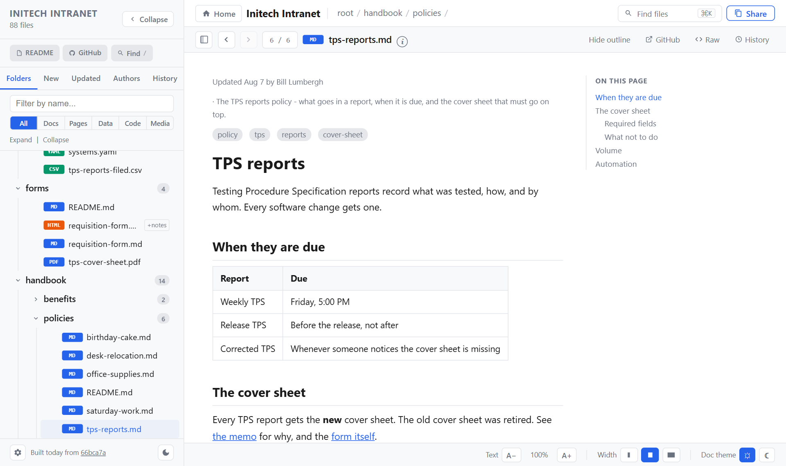
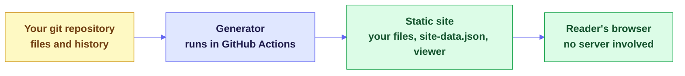

<a id="readme-top"></a>

# [Repo Pages](https://github.com/prisant-labs/repo-pages)

**A website for any git repository, where every file is readable and the history is one click away. It needs no server and no frontend build.**

repo-pages renders Markdown, runs HTML pages, turns CSV files into sortable tables and highlights code. It builds its folder tree and its New, Updated, Authors and History tabs from your commits. Publishing takes one small workflow file, and the site rebuilds on every push.

[**Live demo**](https://projects.prisantlabs.com/repo-pages/) &nbsp;·&nbsp; [**What it is**](#-what-this-is) &nbsp;·&nbsp; [**Publish yours**](#publish-in-four-commands) &nbsp;·&nbsp; [**Agent prompt**](#publish-with-a-coding-agent) &nbsp;·&nbsp; [**Updates**](#get-updates) &nbsp;·&nbsp; [**FAQ**](#-faq) &nbsp;·&nbsp; [**Docs**](#-documentation)

<p>
  <a href="https://github.com/prisant-labs/repo-pages/issues/new?template=bug_report.yml">Report a Bug</a>
  &nbsp;&middot;&nbsp;
  <a href="https://github.com/prisant-labs/repo-pages/issues/new?template=feature_request.yml">Request a Feature</a>
</p>

<p>
  
  <a href="LICENSE"></a>
  <a href="https://github.com/prisant-labs/repo-pages/releases"></a>
  <a href="https://projects.prisantlabs.com/repo-pages/"></a>
  <a href="https://github.com/prisant-labs/repo-pages/actions/workflows/demo.yml"></a>
  
  
  
  <a href="#-what-a-reader-gets"></a>
  <a href="#-project-status"></a>
</p>

<a href="https://projects.prisantlabs.com/repo-pages/"></a>

---

<details>
<summary><strong>Table of Contents</strong></summary>

- [What this is](#-what-this-is)
- [Quick start](#-quick-start)
  - [Try the demo](#try-the-demo) · [Publish in four commands](#publish-in-four-commands) · [Publish with a coding agent](#publish-with-a-coding-agent) · [Configure it](#configure-it) · [Get updates](#get-updates)
- [What makes it different](#-what-makes-it-different)
- [What a reader gets](#-what-a-reader-gets)
- [FAQ](#-faq)
- [Find your way in](#-find-your-way-in)
- [Documentation](#-documentation)
- [Project status](#-project-status)
  - [At a glance](#at-a-glance) · [Repo structure](#repo-structure) · [Changelog](#changelog)
- [Contributing](#-contributing)
- [License](#-license)
- [About the maintainer](#-about-the-maintainer)

</details>

---

## 📦 What this is

repo-pages has two parts, and neither of them runs on a server. A GitHub Action brings them to your repository, so you copy nothing.

- **A viewer:** one static HTML file with two vendored libraries.
- **A generator:** a Python script, using only the standard library, that reads git history and writes the site.



| It is | It is not |
|---|---|
| **The whole repository** - data, code and HTML pages sit beside the Markdown | A documentation theme that publishes only curated pages |
| **Built from git** - the tabs and dates come from your commits | A site whose navigation you maintain by hand |
| **Static** - GitHub Pages or any file host can serve it | A service to run, or a database to keep alive |
| **Small** - one HTML file and one Python script, with no frontend build | An npm project with a dependency tree to maintain |
| **Public once published** - see the [FAQ](#-faq) before you deploy | A private wiki |

<p align="right">(<a href="#readme-top">back to top</a>)</p>

---

## ⚡ Quick start

### Try the demo

**[Open the live demo](https://projects.prisantlabs.com/repo-pages/).** It runs the real viewer and generator over the [Initech sample](examples/README.md), a parody company intranet. Every change to the viewer, generator or sample rebuilds it, so it always shows the latest version.

Things to try:

1. Press the gear in the lower left, and change Interface text and Tree text. The document text does not change size.
2. Turn on **Alternating row colors** and **Folder icons**, then open and close some folders.
3. Open `projects/y2k-remediation/notes/standups/day-03.md` and press `?` to open the jump list.
4. Open `data/tps-reports-filed.csv` and sort a column.

To build the same page yourself:

```bash
python3 examples/build_demo.py --viewer viewer --generator generator/build_site.py
python3 -m http.server 8000 --directory _site
```

Then open `http://localhost:8000`. On Windows, use `python` if `python3` is not found.

### Publish in four commands

> [!WARNING]
> repo-pages publishes nearly every tracked file, and a GitHub Pages site can be public even when its repository is private. Read the [FAQ](#-faq) first. The action refuses a private repository unless you tell it otherwise.

Run these in the repository you want to publish. The `gh` command needs the [GitHub CLI](https://cli.github.com), or you can set **Settings > Pages > Source** to **GitHub Actions** instead.

```bash
mkdir -p .github/workflows
curl -fsSL https://raw.githubusercontent.com/prisant-labs/repo-pages/v1/templates/repo-pages.yml -o .github/workflows/repo-pages.yml
gh api -X POST "repos/{owner}/{repo}/pages" -f build_type=workflow
git add .github/workflows/repo-pages.yml && git commit -m "Publish with repo-pages" && git push
```

That is the whole install. The [workflow](templates/repo-pages.yml) is one small file, and the viewer and generator come from the action. If your default branch is not `main`, change the branch name in the workflow. Each run's summary page lists every file it published, so you can check what went public.

### Publish with a coding agent

Paste this prompt into a coding agent that is open in the repository you want to publish. It does the same install, and it first reviews what would go public, which a workflow cannot judge.

```text
Publish this repository as a repo-pages site on GitHub Pages, using the action at
https://github.com/prisant-labs/repo-pages.

Stop and wait for my answer at each step marked STOP.
Work on a new branch, and do not push to the default branch.

1. Show me what would go public.
   - Tell me this repository's visibility. A GitHub Pages site can be public on the
     internet even when its repository is private, so the action refuses a private
     repository unless `allow-private-repository` is "true".
   - Run `git ls-files`. repo-pages publishes every tracked file, except `.github/**`,
     hidden files, symlinks and submodules.
   - Point out anything that looks like a secret, personal data or a private note.
   - Point out a top-level `index.html` or `site-data.json`. These collide with the
     viewer, so they must be excluded or renamed.
   - Remind me that the site shows commit author names and commit subjects.
   - STOP. Ask me to approve publishing, to name anything to exclude, and whether I
     want a site title.

2. Add the workflow.
   - Download https://raw.githubusercontent.com/prisant-labs/repo-pages/v1/templates/repo-pages.yml
     to `.github/workflows/repo-pages.yml`. If this repository's default branch is not
     `main`, change the branch there.
   - If I named exclusions or a title, write `.github/repo-pages.json` with the keys
     `title` and `exclude`. If this repository holds HTML I may not fully trust, add
     `"sandboxHtml": true` and tell me.

3. Open a pull request.

4. Turn on GitHub Pages.
   - STOP. Ask me whether to run this, or whether I will set Settings > Pages > Source
     to "GitHub Actions" myself:
     `gh api -X POST "repos/{owner}/{repo}/pages" -f build_type=workflow`
     If Pages already exists, the same command with `-X PUT` switches its source.

5. STOP. Ask me to merge the pull request. After the merge, confirm that the
   "Repo Pages" workflow succeeded, give me the site's URL, and point me to the run's
   summary page, which lists every published file.
```

### Configure it

Everything is optional. To change a default, add `.github/repo-pages.json`, which is never published:

```json
{
  "title": "My Docs",
  "description": "What this site is for.",
  "exclude": ["drafts/**"],
  "includeHidden": false,
  "sandboxHtml": false
}
```

The title defaults to the repository's name. The action also takes these inputs:

| Input | Default | What it does |
|---|---|---|
| `deploy` | `true` | Set to `false` to build without publishing, for example on pull requests |
| `allow-private-repository` | `false` | Set to `true` to publish from a private repository |
| `token` | `github.token` | The token for the repository checks, checkout and deployment |

To preview a site on your own machine, build it from a clone of this repository, and do not commit `_site/`:

```bash
git clone --depth 1 https://github.com/prisant-labs/repo-pages /tmp/repo-pages
python3 /tmp/repo-pages/generator/build_site.py --viewer /tmp/repo-pages/viewer --out _site
python3 -m http.server 8000 --directory _site
```

### Get updates

A site picks up a new version when it rebuilds. Choose how much control you want:

- **Follow `@v1` (the default).** Each rebuild uses the latest `v1` release, so fixes arrive by themselves. A quiet repository rebuilds rarely, so the workflow has a weekly `schedule` line you can uncomment.
- **Pin a commit.** Reference a full commit SHA, and add a version comment on the same line. Nothing changes until you accept it. [Dependabot](https://docs.github.com/en/code-security/how-tos/secure-your-supply-chain/secure-your-dependencies/keeping-your-actions-up-to-date-with-dependabot) can open a pull request for each release:

  ```yaml
  # .github/dependabot.yml
  version: 2
  updates:
    - package-ecosystem: github-actions
      directory: /
      schedule:
        interval: weekly
  ```

- **Run your own fork.** Point `uses:` at your fork, and merge from this repository when you choose.

The viewer and generator always ship together, so they cannot get out of step. The action's inputs and the keys in `repo-pages.json` are the public contract. Anything that breaks them gets a new major version, `v2`, which you opt into.

<p align="right">(<a href="#readme-top">back to top</a>)</p>

---

## 🔎 What makes it different

- **It shows the repository, not a curated subset.** A CSV opens as a table beside the Markdown that explains it, and an HTML page runs beside its notes.
- **History is part of the interface.** The New, Updated, Authors and History tabs come straight from commits, so they need no front matter or upkeep.
- **There is nothing to host or copy.** The output is static files, and the viewer loads nothing from the network. Your repository holds one workflow file.
- **Fixes reach you.** A site that follows `@v1` picks up each release on its next rebuild, and a pinned site can take them as pull requests.
- **It checks before it publishes.** The action refuses a private repository by default, and it names the exact setting when something is missing.
- **The demo cannot drift.** Each build uses the viewer and generator from the same commit. It publishes only if the tests and 64 browser checks pass.
- **Untrusted content is treated as data.** Rendered Markdown passes through DOMPurify, and `sandboxHtml` isolates HTML pages you do not fully trust. [SECURITY.md](SECURITY.md) has the details.

<p align="right">(<a href="#readme-top">back to top</a>)</p>

---

## 🧩 What a reader gets

- A folder tree, plus New, Updated, Authors and History tabs built from commits.
- A view for each file type, as the table below shows.
- Breadcrumb menus, a file jump list, folder pages and a command palette (`/` or Cmd+K).
- Paired notes, which show `page.md` beside `page.html`.
- Settings for the theme, interface text, tree text, row stripes, folder icons, sorting and more.

| File type | What the reader sees |
|---|---|
| Markdown | Rendered text, with front matter tags and an "On this page" outline |
| HTML | The page itself, running |
| CSV | A table that sorts and filters |
| JSON and YAML | A dedicated view of the data |
| Code | Highlighted source |
| Images and PDF | The file itself, inline |
| Anything else | A download card |

[docs/features.md](docs/features.md) has the full list, including what is not built.

<p align="right">(<a href="#readme-top">back to top</a>)</p>

---

## ❓ FAQ

**Does every tracked file get published?** Yes, apart from `.github/**`, hidden files, symlinks, submodules and your `exclude` patterns. Check what you are publishing before you deploy.

**Does a site name people?** Yes. It shows commit author names and commit subjects, and the Authors tab lists everyone. It does not publish author email addresses.

**Do HTML files run?** Yes, on the site's own origin by default. Set `sandboxHtml` to `true` if you publish HTML you do not fully trust. [SECURITY.md](SECURITY.md) explains why.

**Is the site private?** Not by default. A GitHub Pages site is public on the internet even when its repository is private. GitHub offers access-controlled Pages only on certain plans, so check GitHub's current rules before you publish anything sensitive.

**Why does the Updated tab show one author for everything?** The site was built from a shallow clone. Build with full history.

**How current is the live demo?** A workflow rebuilds it on every push to `main` that touches the viewer, generator, sample or checks. It publishes only if the tests and browser checks pass.

**Are reader settings shared between readers?** No. They live in each reader's browser storage. If storage is blocked, the defaults apply.

**How do I get fixes, including security fixes?** A workflow that uses `@v1` picks them up on its next rebuild. A workflow pinned to a commit needs that pin updated. [Get updates](#get-updates) compares the options.

**Can I publish from a private repository?** Only if your GitHub plan allows it, and you set `allow-private-repository` to `true`. The action refuses by default, because the site can be public even so.

**What can make the workflow fail?** The action's error names the fix in three cases. GitHub Pages is off or set to a branch, the job lacks `id-token: write`, or the repository is private. A missing `pages: write` fails at deployment, and GitHub's message names it. A top-level `index.html` or `site-data.json` collides with the viewer, so exclude or rename it.

**Which runners does it support?** It is tested on `ubuntu-latest`. It needs `python3` 3.10 or later and `bash` on the runner.

<p align="right">(<a href="#readme-top">back to top</a>)</p>

---

## 🧭 Find your way in

| If you want to... | Start here |
|---|---|
| See it working | The [live demo](https://projects.prisantlabs.com/repo-pages/) |
| Publish your repository | [Four commands](#publish-in-four-commands) or [a coding agent](#publish-with-a-coding-agent) |
| Control how updates arrive | [Get updates](#get-updates) |
| Decide whether a site is safe to publish | The [FAQ](#-faq) and [SECURITY.md](SECURITY.md) |
| Know every setting a reader can change | [docs/settings-spec.md](docs/settings-spec.md) |
| Understand how the parts fit together | [docs/architecture.md](docs/architecture.md) |
| Report a problem or propose a change | [CONTRIBUTING.md](CONTRIBUTING.md) |

<p align="right">(<a href="#readme-top">back to top</a>)</p>

---

## 📖 Documentation

| Document | Read it to learn |
|---|---|
| [docs/features.md](docs/features.md) | What the viewer does today, and what is not built |
| [docs/settings-spec.md](docs/settings-spec.md) | Every reader setting, its values, default and storage key |
| [docs/design.md](docs/design.md) | Layout values, colors, tree geometry and screenshots |
| [docs/architecture.md](docs/architecture.md) | How the viewer, generator, demo and checks fit together |
| [docs/ideas.md](docs/ideas.md) | Features worth considering |
| [examples/README.md](examples/README.md) | The Initech sample and how to change it |
| [CHANGELOG.md](CHANGELOG.md) | What changed |
| [THIRD-PARTY-NOTICES.md](THIRD-PARTY-NOTICES.md) | Licenses for the vendored libraries and icon shapes |
| [CONTRIBUTING.md](CONTRIBUTING.md) | How to report a bug, run the checks and open a pull request |
| [SECURITY.md](SECURITY.md) | How to report a vulnerability, and what the project treats as in scope |

<p align="right">(<a href="#readme-top">back to top</a>)</p>

---

## 📊 Project status

**Active.** The action, viewer and generator are at v1, and they run the live demo. Full history is in [`CHANGELOG.md`](CHANGELOG.md).

### At a glance

|  |  |
|---|---|
| **Latest release** | [v1.0.1](https://github.com/prisant-labs/repo-pages/releases/tag/v1.0.1) |
| **Install** | One workflow file, using `prisant-labs/repo-pages@v1` |
| **Live demo** | [projects.prisantlabs.com/repo-pages](https://projects.prisantlabs.com/repo-pages/), rebuilt from `main` |
| **Viewer** | One HTML file, plus `marked` and DOMPurify at pinned versions |
| **Generator** | One Python script, using only the standard library |
| **Sample** | 88 parody files and a script of 41 commits |
| **Checks** | Generator tests and 64 browser checks, required on every pull request |
| **License** | [MIT](LICENSE) |

### Repo structure

```
repo-pages/
├── action.yml             # the GitHub Action
├── viewer/                # the whole interface, in one HTML file
│   └── vendor/            #   pinned copies of marked and DOMPurify
├── generator/             # build_site.py, preflight.py and their tests
├── templates/             # the workflow to copy into your repository
├── examples/              # the Initech sample and the demo build
├── tests/                 # browser checks, their runner, and the vendor watch list
├── docs/                  # features, settings, design, architecture and ideas
├── .github/               # the demo workflow, Dependabot, and issue forms
├── CHANGELOG.md
├── CONTRIBUTING.md
├── SECURITY.md
├── THIRD-PARTY-NOTICES.md
└── LICENSE
```

### Changelog

Full detail is in [`CHANGELOG.md`](CHANGELOG.md), and each version is on the [releases page](https://github.com/prisant-labs/repo-pages/releases).

<p align="right">(<a href="#readme-top">back to top</a>)</p>

---

## 🤝 Contributing

Bug reports, ideas and code are all welcome. The project has three firm limits. The viewer stays one file with no build step, the generator uses only the Python standard library, and the sample stays fictional.

Run the checks before you open a pull request, so CI confirms your result rather than discovering a problem. [`CONTRIBUTING.md`](CONTRIBUTING.md) has the commands and the full process. Report security problems privately, as [`SECURITY.md`](SECURITY.md) describes.

<p align="right">(<a href="#readme-top">back to top</a>)</p>

---

## 📄 License

repo-pages is under the [MIT license](LICENSE). The vendored libraries and icon shapes keep their own licenses, as [THIRD-PARTY-NOTICES.md](THIRD-PARTY-NOTICES.md) lists.

The Initech sample is a parody of the 1999 film *Office Space*, and it is not affiliated with the film or its owners. The license covers the sample's original text, and it grants no rights to the film's names or characters.

<p align="right">(<a href="#readme-top">back to top</a>)</p>

---

## 👋 About the maintainer

<a href="https://github.com/jprisant"></a>

Built and maintained by **Jonathan Prisant** ([@jprisant](https://github.com/jprisant)) under the [`prisant-labs`](https://github.com/prisant-labs) organization, for anyone who wants a repository to be readable on the web.

*If repo-pages made a repository easier to read, consider starring the repo and sharing it.*

<p align="center">
  <strong>Built by <a href="https://github.com/prisant-labs">prisant-labs</a></strong><br>
  <sub>Every file in your repository, readable on the web, with no server to run</sub>
</p>

<div align="right"><a href="#readme-top">Back to top ↑</a></div>
