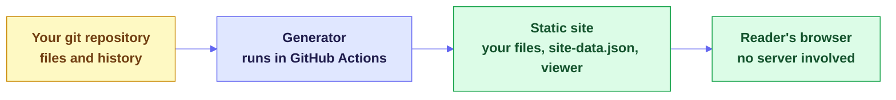

<a id="readme-top"></a>

# [Repo Pages](https://github.com/prisant-labs/repo-pages)

**A website for any git repository, where every file is readable and the history is one click away. It needs no server and no frontend build.**

repo-pages renders Markdown, runs HTML pages, turns CSV files into sortable tables and highlights code. It builds its folder tree and its New, Updated, Authors and History tabs from your commits. The site rebuilds from git on every push.

[**Live demo**](https://projects.prisantlabs.com/repo-pages/) &nbsp;·&nbsp; [**What it is**](#-what-this-is) &nbsp;·&nbsp; [**Quick start**](#-quick-start) &nbsp;·&nbsp; [**Agent prompt**](#publish-with-a-coding-agent) &nbsp;·&nbsp; [**FAQ**](#-faq) &nbsp;·&nbsp; [**Docs**](#-documentation)

<p>
  <a href="https://github.com/prisant-labs/repo-pages/issues/new?template=bug_report.yml">Report a Bug</a>
  &nbsp;&middot;&nbsp;
  <a href="https://github.com/prisant-labs/repo-pages/issues/new?template=feature_request.yml">Request a Feature</a>
</p>

<p>
  
  <a href="LICENSE"></a>
  <a href="https://projects.prisantlabs.com/repo-pages/"></a>
  <a href="https://github.com/prisant-labs/repo-pages/actions/workflows/demo.yml"></a>
  
  
  
  <a href="#-what-a-reader-gets"></a>
  <a href="#-project-status"></a>
</p>

<a href="https://projects.prisantlabs.com/repo-pages/"></a>

---

<details>
<summary><strong>Table of Contents</strong></summary>

- [What this is](#-what-this-is)
- [Quick start](#-quick-start)
  - [Try the demo](#try-the-demo) · [Publish with a coding agent](#publish-with-a-coding-agent) · [Publish by hand](#publish-by-hand) · [Update your copy](#update-your-copy)
- [What makes it different](#-what-makes-it-different)
- [What a reader gets](#-what-a-reader-gets)
- [FAQ](#-faq)
- [Find your way in](#-find-your-way-in)
- [Documentation](#-documentation)
- [Project status](#-project-status)
  - [At a glance](#at-a-glance) · [Repo structure](#repo-structure) · [Changelog](#changelog)
- [Contributing](#-contributing)
- [License](#-license)
- [About the maintainer](#-about-the-maintainer)

</details>

---

## 📦 What this is

repo-pages has two parts, and neither of them runs on a server:

- **A viewer:** one static HTML file with two vendored libraries.
- **A generator:** a Python script, using only the standard library, that reads git history and writes the site.



| It is | It is not |
|---|---|
| **The whole repository** - data, code and HTML pages sit beside the Markdown | A documentation theme that publishes only curated pages |
| **Built from git** - the tabs and dates come from your commits | A site whose navigation you maintain by hand |
| **Static** - GitHub Pages or any file host can serve it | A service to run, or a database to keep alive |
| **Small** - one HTML file and one Python script, with no frontend build | An npm project with a dependency tree to maintain |
| **Public once published** - see the [FAQ](#-faq) before you deploy | A private wiki |

<p align="right">(<a href="#readme-top">back to top</a>)</p>

---

## ⚡ Quick start

### Try the demo

**[Open the live demo](https://projects.prisantlabs.com/repo-pages/).** It runs the real viewer and generator over the [Initech sample](examples/README.md), a parody company intranet. Every change to the viewer, generator or sample rebuilds it, so it always shows the latest version.

Things to try:

1. Press the gear in the lower left, and change Interface text and Tree text. The document text does not change size.
2. Turn on **Alternating row colors** and **Folder icons**, then open and close some folders.
3. Open `projects/y2k-remediation/notes/standups/day-03.md` and press `?` to open the jump list.
4. Open `data/tps-reports-filed.csv` and sort a column.

To build the same page yourself:

```bash
python3 examples/build_demo.py --viewer viewer --generator generator/build_site.py
python3 -m http.server 8000 --directory _site
```

Then open `http://localhost:8000`. On Windows, use `python` if `python3` is not found.

### Publish with a coding agent

> [!WARNING]
> repo-pages publishes nearly every tracked file, and a GitHub Pages site is public even when its repository is private. The prompt below makes the agent stop and show you what would go public.

Paste this prompt into a coding agent that is open in the repository you want to publish:

```text
Publish this repository as a repo-pages site on GitHub Pages.
The project is at https://github.com/prisant-labs/repo-pages.

Stop and wait for my answer at each step marked STOP.
Work on a new branch, and do not push to the default branch.

1. Show me what would go public.
   - Tell me this repository's visibility. A GitHub Pages site is public on the
     internet, even when its repository is private.
   - Run `git ls-files`. repo-pages publishes every tracked file, except
     `.github/**`, hidden files, symlinks and submodules.
   - Point out anything that looks like a secret, personal data or a private note.
   - Remind me that the site shows commit author names and commit subjects.
   - STOP. Ask me to approve publishing, and to name anything to exclude.

2. Install repo-pages.
   - Clone https://github.com/prisant-labs/repo-pages into a temporary folder
     outside this repository, and note its commit.
   - Create `.github/site/`, and copy the contents of its `viewer/` folder there.
   - Copy its `generator/build_site.py` to `.github/scripts/build_site.py`.
   - Copy its `templates/repo-pages.yml` to `.github/workflows/repo-pages.yml`.
     If this repository's default branch is not `main`, change the branch there.
   - Write `.github/site/config.json` with these keys: `title`, `description`,
     `exclude` (my patterns from step 1), `includeHidden` (false) and
     `sandboxHtml` (false). If this repository holds HTML I may not fully trust,
     set `sandboxHtml` to true and tell me.
   - Add `_site/` to `.gitignore`.

3. Test it.
   - Make sure this clone has full history. Run `git fetch --unshallow` if it is shallow.
   - Run `python3 .github/scripts/build_site.py --out _site`. Use `python` if `python3`
     is not found.
   - Confirm that every excluded file is absent from `_site/`, and tell me how many
     files were published.
   - Serve `_site/` with `python3 -m http.server`, then open it in a browser if you can.
     Opening `index.html` from disk will not work.

4. Open a pull request, and name the repo-pages commit you copied in its description.

5. Turn on GitHub Pages.
   - STOP. Ask me whether to run this, or whether I will set Settings > Pages > Source
     to "GitHub Actions" myself:
     `gh api -X POST "repos/{owner}/{repo}/pages" -f build_type=workflow`
     If Pages already exists, the same command with `-X PUT` switches its source.

6. STOP. Ask me to merge the pull request. After the merge, confirm that the
   "Repo Pages" workflow succeeded, and give me the site's URL.
```

### Publish by hand

1. Copy three things from this repository into yours:

   ```bash
   git clone --depth 1 https://github.com/prisant-labs/repo-pages /tmp/repo-pages
   mkdir -p .github/site .github/scripts .github/workflows
   cp -r /tmp/repo-pages/viewer/. .github/site/
   cp /tmp/repo-pages/generator/build_site.py .github/scripts/build_site.py
   cp /tmp/repo-pages/templates/repo-pages.yml .github/workflows/repo-pages.yml
   ```

2. Add `.github/site/config.json`. Every key is optional:

   ```json
   {
     "title": "My Docs",
     "description": "What this site is for.",
     "exclude": ["drafts/**"],
     "includeHidden": false,
     "sandboxHtml": false
   }
   ```

3. Build it with full git history, and read through what it published:

   ```bash
   python3 .github/scripts/build_site.py --out _site
   python3 -m http.server 8000 --directory _site
   ```

4. Set **Settings > Pages > Source** to **GitHub Actions**. Then commit and push to your default branch. Do not commit `_site/`.

The [workflow](templates/repo-pages.yml) checks out with `fetch-depth: 0`, because a shallow clone gives every file the same author and date.

### Update your copy

Your repository holds a copy of the viewer and generator, so fixes do not reach it by themselves. To update, repeat the copy steps. Your `config.json` stays, because the viewer folder does not contain one. Delete `.github/site/vendor/` first, so older library versions do not linger. Agents can use this prompt:

```text
Update repo-pages in this repository from https://github.com/prisant-labs/repo-pages.
Work on a new branch. Clone that repository into a temporary folder outside this one.
Delete `.github/site/vendor/`, then copy the contents of its `viewer/` folder to
`.github/site/`, and keep our `config.json`. Replace `.github/scripts/build_site.py`
with its `generator/build_site.py`. Compare `.github/workflows/repo-pages.yml` with its
`templates/repo-pages.yml`, and tell me about any differences. Build with
`python3 .github/scripts/build_site.py --out _site`, then open a pull request.
Summarize the relevant entries from its `CHANGELOG.md` in the description.
```

<p align="right">(<a href="#readme-top">back to top</a>)</p>

---

## 🔎 What makes it different

- **It shows the repository, not a curated subset.** A CSV opens as a table beside the Markdown that explains it, and an HTML page runs beside its notes.
- **History is part of the interface.** The New, Updated, Authors and History tabs come straight from commits, so they need no front matter or upkeep.
- **There is nothing to host.** The output is static files. The generator needs only Python and git, and the viewer loads nothing from the network.
- **The demo cannot drift.** Each build uses the viewer and generator from the same commit. It publishes only if the tests and 64 browser checks pass.
- **Untrusted content is treated as data.** Rendered Markdown passes through DOMPurify, and `sandboxHtml` isolates HTML pages you do not fully trust. [SECURITY.md](SECURITY.md) has the details.

<p align="right">(<a href="#readme-top">back to top</a>)</p>

---

## 🧩 What a reader gets

- A folder tree, plus New, Updated, Authors and History tabs built from commits.
- A view for each file type, as the table below shows.
- Breadcrumb menus, a file jump list, folder pages and a command palette (`/` or Cmd+K).
- Paired notes, which show `page.md` beside `page.html`.
- Settings for the theme, interface text, tree text, row stripes, folder icons, sorting and more.

| File type | What the reader sees |
|---|---|
| Markdown | Rendered text, with front matter tags and an "On this page" outline |
| HTML | The page itself, running |
| CSV | A table that sorts and filters |
| JSON and YAML | A dedicated view of the data |
| Code | Highlighted source |
| Images and PDF | The file itself, inline |
| Anything else | A download card |

[docs/features.md](docs/features.md) has the full list, including what is not built.

<p align="right">(<a href="#readme-top">back to top</a>)</p>

---

## ❓ FAQ

**Does every tracked file get published?** Yes, apart from `.github/**`, hidden files, symlinks, submodules and your `exclude` patterns. Check what you are publishing before you deploy.

**Does a site name people?** Yes. It shows commit author names and commit subjects, and the Authors tab lists everyone. It does not publish author email addresses.

**Do HTML files run?** Yes, on the site's own origin by default. Set `sandboxHtml` to `true` if you publish HTML you do not fully trust. [SECURITY.md](SECURITY.md) explains why.

**Is the site private?** Not by default. A GitHub Pages site is public on the internet even when its repository is private. GitHub offers access-controlled Pages only on certain plans, so check GitHub's current rules before you publish anything sensitive.

**Why does the Updated tab show one author for everything?** The site was built from a shallow clone. Build with full history.

**How current is the live demo?** A workflow rebuilds it on every push to `main` that touches the viewer, generator, sample or checks. It publishes only if the tests and browser checks pass.

**Are reader settings shared between readers?** No. They live in each reader's browser storage. If storage is blocked, the defaults apply.

**How do I get fixes, including security fixes?** Repeat the copy steps in [Update your copy](#update-your-copy). Your site does not update by itself, and the project has no versioned releases yet.

<p align="right">(<a href="#readme-top">back to top</a>)</p>

---

## 🧭 Find your way in

| If you want to... | Start here |
|---|---|
| See it working | The [live demo](https://projects.prisantlabs.com/repo-pages/) |
| Publish your repository | [Publish with a coding agent](#publish-with-a-coding-agent) or [by hand](#publish-by-hand) |
| Decide whether a site is safe to publish | The [FAQ](#-faq) and [SECURITY.md](SECURITY.md) |
| Know every setting a reader can change | [docs/settings-spec.md](docs/settings-spec.md) |
| Understand how the parts fit together | [docs/architecture.md](docs/architecture.md) |
| Report a problem or propose a change | [CONTRIBUTING.md](CONTRIBUTING.md) |

<p align="right">(<a href="#readme-top">back to top</a>)</p>

---

## 📖 Documentation

| Document | Read it to learn |
|---|---|
| [docs/features.md](docs/features.md) | What the viewer does today, and what is not built |
| [docs/settings-spec.md](docs/settings-spec.md) | Every reader setting, its values, default and storage key |
| [docs/design.md](docs/design.md) | Layout values, colors, tree geometry and screenshots |
| [docs/architecture.md](docs/architecture.md) | How the viewer, generator, demo and checks fit together |
| [docs/ideas.md](docs/ideas.md) | Features worth considering |
| [examples/README.md](examples/README.md) | The Initech sample and how to change it |
| [CHANGELOG.md](CHANGELOG.md) | What changed |
| [THIRD-PARTY-NOTICES.md](THIRD-PARTY-NOTICES.md) | Licenses for the vendored libraries and icon shapes |
| [CONTRIBUTING.md](CONTRIBUTING.md) | How to report a bug, run the checks and open a pull request |
| [SECURITY.md](SECURITY.md) | How to report a vulnerability, and what the project treats as in scope |

<p align="right">(<a href="#readme-top">back to top</a>)</p>

---

## 📊 Project status

**Pre-release.** The viewer and generator work today, and they run the live demo. The project has no versioned releases yet, so changes land on `main`. Full history is in [`CHANGELOG.md`](CHANGELOG.md).

### At a glance

|  |  |
|---|---|
| **Latest release** | None yet |
| **Live demo** | [projects.prisantlabs.com/repo-pages](https://projects.prisantlabs.com/repo-pages/), rebuilt from `main` |
| **Viewer** | One HTML file, plus `marked` and DOMPurify at pinned versions |
| **Generator** | One Python script, using only the standard library |
| **Sample** | 88 parody files and a script of 41 commits |
| **Checks** | Generator tests and 64 browser checks, required on every pull request |
| **License** | [MIT](LICENSE) |

### Repo structure

```
repo-pages/
├── viewer/                # the whole interface, in one HTML file
│   └── vendor/            #   pinned copies of marked and DOMPurify
├── generator/             # build_site.py and its tests
├── templates/             # the workflow to copy into your repository
├── examples/              # the Initech sample and the demo build
├── tests/                 # browser checks, their runner, and the vendor watch list
├── docs/                  # features, settings, design, architecture and ideas
├── .github/               # the demo workflow, Dependabot, and issue forms
├── CHANGELOG.md
├── CONTRIBUTING.md
├── SECURITY.md
├── THIRD-PARTY-NOTICES.md
└── LICENSE
```

### Changelog

Full detail is in [`CHANGELOG.md`](CHANGELOG.md). Changes collect under "Unreleased" until the first versioned release.

<p align="right">(<a href="#readme-top">back to top</a>)</p>

---

## 🤝 Contributing

Bug reports, ideas and code are all welcome. The project has three firm limits. The viewer stays one file with no build step, the generator uses only the Python standard library, and the sample stays fictional.

Run the checks before you open a pull request, so CI confirms your result rather than discovering a problem. [`CONTRIBUTING.md`](CONTRIBUTING.md) has the commands and the full process. Report security problems privately, as [`SECURITY.md`](SECURITY.md) describes.

<p align="right">(<a href="#readme-top">back to top</a>)</p>

---

## 📄 License

repo-pages is under the [MIT license](LICENSE). The vendored libraries and icon shapes keep their own licenses, as [THIRD-PARTY-NOTICES.md](THIRD-PARTY-NOTICES.md) lists.

The Initech sample is a parody of the 1999 film *Office Space*, and it is not affiliated with the film or its owners. The license covers the sample's original text, and it grants no rights to the film's names or characters.

<p align="right">(<a href="#readme-top">back to top</a>)</p>

---

## 👋 About the maintainer

<a href="https://github.com/jprisant"></a>

Built and maintained by **Jonathan Prisant** ([@jprisant](https://github.com/jprisant)) under the [`prisant-labs`](https://github.com/prisant-labs) organization, for anyone who wants a repository to be readable on the web.

*If repo-pages made a repository easier to read, consider starring the repo and sharing it.*

<p align="center">
  <strong>Built by <a href="https://github.com/prisant-labs">prisant-labs</a></strong><br>
  <sub>Every file in your repository, readable on the web, with no server to run</sub>
</p>

<div align="right"><a href="#readme-top">Back to top ↑</a></div>
