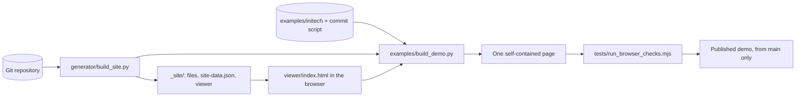

# Architecture

repo-pages has no server and no frontend build step. A generator turns a git repository into static files, and one HTML file reads those files in the browser.



## Parts

| Part | Path | What it does |
|---|---|---|
| Viewer | `viewer/index.html` | The whole interface, in one file with inline CSS and JavaScript |
| Vendored libraries | `viewer/vendor/` | `marked` and DOMPurify, loaded on the first Markdown render |
| Generator | `generator/build_site.py` | Copies published files, adds the viewer and writes `site-data.json` |
| Generator tests | `generator/test_build_site.py` | Standard library `unittest` tests that build temporary repositories |
| Sample | `examples/initech/`, `examples/initech-history.json` | 88 parody files, and a script of 41 commits that gives them a history |
| Demo build | `examples/build_demo.py` | Replays the history, runs the generator and folds everything into one page |
| Browser checks | `tests/browser_checks.js` | 48 settings behavior checks that run inside the page |
| Check runner | `tests/run_browser_checks.mjs` | Opens a build or a URL in a browser and fails on any failed check |
| Workflow | `.github/workflows/demo.yml` | Runs the tests, build and checks, then publishes the demo from `main` |

## Two layouts

This repository keeps the viewer in `viewer/` and the generator in `generator/`, because they are the product here.

The generator expects a different layout in the repository it publishes. `SITE_DIR` in `build_site.py` is `.github/site`, and `.github/**` is never published. A consumer therefore copies the viewer to `.github/site/` and the generator to `.github/scripts/`. `build_demo.py` takes both paths as arguments and sets up that layout in a temporary repository.

## The data contract

The generator writes `site-data.json` next to the viewer. It holds the site config, the commit list and one entry per file. Each file entry holds the size, the last change, the first add and the Markdown front matter. A rename map comes from the `R` lines in `git log`. The viewer reads nothing else at boot, so another data source could replace git without viewer changes.

## How the demo works

`build_demo.py` does four things:

1. It replays `initech-history.json` into a temporary git repository, with backdated authors and commit dates.
2. It runs the real generator on that repository.
3. It swaps three lines in the viewer, so files load from the page instead of the server. Each swap must match exactly once, so the build stops if those lines change.
4. It writes one HTML file with the libraries, the data file and every published file inlined.

Dates are relative to the build, so the output changes on every run. **Do not commit the built page.** Build it where you need it.

## Continuous integration

`.github/workflows/demo.yml` runs on pull requests and on pushes to `main` that touch `viewer/`, `generator/`, `examples/`, `tests/` or the workflow. It can also be started by hand.

| Job | Runs on | What it does |
|---|---|---|
| `build` | Every trigger | Tests the generator, builds the demo, runs the browser checks and uploads the page |
| `deploy` | `main` only, not pull requests | Publishes the uploaded page to GitHub Pages |

The demo comes from the viewer and generator in the same commit, so it cannot fall behind them. A failed test or check stops the run before anything is published.

**The published site is public, although this repository is private.** Only the built page is published, which is the viewer, the generator's output and the sample content. It is served at <https://projects.prisantlabs.com/repo-pages/>, because the organization's site owns that domain.

## Settings

All reader settings go through one registry, `PREF_SPEC`, in the viewer. Each entry holds a storage key, a validator and a default. The popover is built from a settings list, and Reset reads its defaults from the registry. A new setting therefore gets validation and reset without extra code. [settings-spec.md](settings-spec.md) has the behavior, and [design.md](design.md) has the measurements.

## Verifying a change

Run these from the repository root. Playwright is not a project dependency, so install it when you need it.

```bash
python3 generator/test_build_site.py
python3 examples/build_demo.py --viewer viewer --generator generator/build_site.py
npm install --no-save --no-package-lock playwright
npx playwright install chromium
node tests/run_browser_checks.mjs
```

The generator tests do not cover the viewer. The browser checks cover settings behavior on one Markdown file, so a change to another view still needs a look in the browser.
