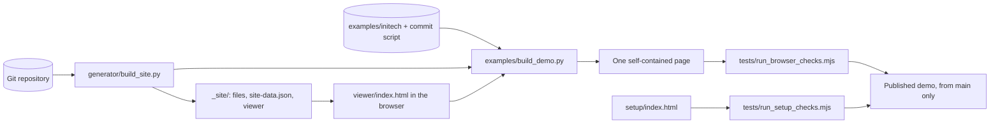

# Architecture

repo-pages has no server and no frontend build step. A generator turns a git repository into static files, and one HTML file reads those files in the browser.



## Parts

| Part | Path | What it does |
|---|---|---|
| Viewer | `viewer/index.html` | The whole interface, in one file with inline CSS and JavaScript |
| Vendored libraries | `viewer/vendor/` | `marked` and DOMPurify, loaded on the first Markdown render |
| Generator | `generator/build_site.py` | Copies published files, adds the viewer, and writes `site-data.json` and `_viewer/refs.json` |
| Generator tests | `generator/test_build_site.py` | Standard library `unittest` tests that build temporary repositories |
| Sample | `examples/initech/`, `examples/initech-history.json` | 88 parody files, and a script of 41 commits that gives them a history |
| Demo build | `examples/build_demo.py` | Replays the history, runs the generator and folds everything into one page |
| Browser checks | `tests/browser_checks.js` | Settings behavior and Referenced by checks that run inside the page. The runner prints the current count |
| Check runner | `tests/run_browser_checks.mjs` | Opens a build or a URL in a browser and fails on any failed check |
| Render check | `tests/run_render_check.mjs` | Opens one Markdown file on an ordinary build, which loads `marked` and DOMPurify by URL, and fails unless both load and the file renders |
| Setup page | `setup/index.html` | A form that writes an adopter's workflow and config files. It is published beside the demo and is not part of any adopter's site |
| Setup check | `tests/run_setup_checks.mjs`, `tests/setup_compare.py` | Runs the setup page in a browser and compares its results with the generator, the preflight, the template and the sample |
| Workflow | `.github/workflows/demo.yml` | Runs the tests, build and checks, then publishes the demo and the setup page from `main` |
| Vendor watch | `tests/vendor-watch/package.json` | Lists the vendored versions so Dependabot reports updates. Nothing installs it |
| Action | `action.yml` | Checks, builds and deploys a repository, using this repository's viewer and generator |
| Preflight | `generator/preflight.py` | Refuses a private repository whose site is public, and turns setup mistakes into errors that name the fix |
| Adopter workflow | `templates/repo-pages.yml` | The one file an adopter adds. It carries the permissions and environment |

## The action

An adopter adds `templates/repo-pages.yml` and copies nothing. The workflow runs `prisant-labs/repo-pages@v1`, a composite action, and GitHub downloads this repository for the run. The action finds the viewer and generator through `$GITHUB_ACTION_PATH`, so they always come from the same commit.

| Step | What it does |
|---|---|
| Preflight | Stops on a private repository whose site is public, and on missing Pages settings or `id-token: write`. It runs first, so nothing is checked out or built on a refusal |
| Checkout | Fetches full history, because authors and dates come from git. It keeps no credentials on disk, because the build does not need them |
| Build | Runs `build_site.py --viewer` into a temporary folder, and writes the published file list to the run's summary page |
| Upload and deploy | Publish the folder to GitHub Pages. The `deploy: false` input skips these steps and the preflight |

Some choices here are worth keeping:

- **The inner actions are pinned to commit SHAs,** because every adopter inherits them. A moved tag upstream cannot change what runs.
- **The upload sets `include-hidden-files: true`.** The upload action otherwise drops dotfiles, which would silently undo `includeHidden`. The generator stays the only place that decides what gets published.
- **A composite action cannot set permissions or an environment,** so the adopter's workflow carries them. The deploy needs `pages: write` and `id-token: write`. It succeeds without `environment`, but the template keeps it, because `deploy-pages` recommends it and it puts the URL on the run page.
- **The preflight decides on the site's visibility, not the repository's.** It reads `public` from the Pages settings. A repository that is private or has internal visibility publishes when `public` is exactly `false`. Otherwise it needs `allow-private-repository`. With `require-private-site`, only `false` publishes, whatever the repository's visibility. A missing or non-boolean `public` counts as public, so a change in GitHub's response can only refuse, never expose a site. If the Pages settings cannot be read, their own error stops the run, and the next run checks visibility.
- **The preflight cannot detect a missing `pages: write` on a public repository,** because reading the settings still succeeds. `deploy-pages` fails with a message that names the permission.

`demo.yml` runs the action with `deploy: false` on every pull request, and checks what it built.

## Two layouts

This repository keeps the viewer in `viewer/` and the generator in `generator/`, because they are the product here.

Without `--viewer`, the generator reads the viewer from `.github/site/` in the repository it publishes. `build_demo.py` sets up that layout in a temporary repository. `.github/**` is never published, so neither the viewer's source nor the config appears as a site file.

The generator reads its config from `.github/repo-pages.json`, and falls back to `.github/site/config.json`. It checks the config before it selects any file or touches the output folder. The config must be a JSON object. `title` and `description` must be strings, `exclude` must be a list of strings, and `includeHidden` and `sandboxHtml` must be `true` or `false`. A wrong type stops the build with the file name and the key. The generator never coerces a value, because under Python truthiness the string `"false"` would turn `includeHidden` on. Unknown keys are ignored.

## What the generator publishes

The generator publishes tracked regular files, minus `.github/**`, hidden files and `exclude` patterns. It reads each file's mode from `git ls-files -s` and skips symlinks and submodules. Copying a symlink would publish its target, which can be outside the repository or a file that `exclude` hides.

## The data contract

The generator writes `site-data.json` next to the viewer. It holds the site config, the commit list and one entry per file. Each file entry holds the size, the last change, the first add and the Markdown front matter. A rename map comes from the `R` lines in `git log`. The viewer reads nothing else at boot, so another data source could replace git without viewer changes.

Generated side files are listed under an `outputs` key, so the viewer fetches only what this build wrote. The key is optional and additive, so `DATA_VERSION` stays 1. The viewer accepts only a plain file name under `_viewer/`. Today the one side file is `_viewer/refs.json`, written when at least one published document links to another published file:

```json
{"version": 1,
 "refs": {"forms/tps-cover-sheet.pdf": [["handbook/policies/tps-reports.md", [{"h": "The cover sheet", "x": "Every TPS report gets the new cover sheet ...", "a": "", "k": "l"}]]]},
 "more": {}}
```

Each key of `refs` is a published file. Each entry names a published Markdown file that links to it, with up to three mentions. A mention holds the nearest heading above the link (`h`), about 160 characters of plain text around it (`x`), the `#fragment` the link used (`a`), and `l` for a link or `i` for an image (`k`). Each file lists at most 25 referring files, and `more` counts the rest. `_viewer/` is reserved, so the file cannot collide with a file in the repository.

The generator finds links with one standard-library scan per Markdown file, `scan_markdown`. It skips front matter, fenced code and code spans, and reads inline links and images plus HTML `<a href>` and ``. It resolves each link with the viewer's own rules: drop the `?query`, percent-decode, resolve `.` and `..`, then follow the rename map. It does not read reference-style links yet. It also does not know indented code blocks, setext headings (a title underlined with `===` or `---`), HTML comments, or HTML blocks in which `marked` leaves Markdown unparsed. Every search in the scan is bounded, by line, block, label and destination length, so a hostile file cannot make it slow. A browser check renders every Markdown file with `marked` and fails if the two link lists differ.

## How the demo works

`build_demo.py` does four things:

1. It replays `initech-history.json` into a temporary git repository, with backdated authors and commit dates.
2. It runs the real generator on that repository.
3. It swaps three lines in the viewer, so files load from the page instead of the server. Each swap must match exactly once, so the build stops if those lines change.
4. It writes one HTML file with the libraries, the data file, the generated side files listed under `outputs`, and every published file inlined. It also adds a `noindex` tag, which matches the projects hub until the project is announced.

Dates are relative to the build, so the output changes on every run. **Do not commit the built page.** Build it where you need it.

## The setup page

`setup/index.html` is one self-contained file, like the viewer. It has no build step, loads nothing from the network and sends nothing anywhere. An adopter fills in a form, and the page writes the files to commit: the workflow, a `repo-pages.json` with only the keys that differ from their defaults, and a Dependabot file for a pinned commit. It also predicts the preflight and classifies a pasted file list.

The page copies its rules from four places, so a check keeps them in step:

| Rule in the page | Copied from | What the check compares |
|---|---|---|
| The default workflow | `templates/repo-pages.yml` | The page's output with every option at its default, byte for byte after line endings are normalized |
| Publish rules | `DEFAULT_EXCLUDE`, `RESERVED`, `VIEWER_DIR`, `REGULAR_MODES` and `glob_to_regex` in `build_site.py` | The constants, and every path of the page's sample list under three pattern sets |
| Config errors | `CONFIG_TYPES` and `check_config` | The key names and wording, and the first error for 17 configs |
| Preflight | `site_refusal` in `preflight.py` | All 36 combinations of repository visibility, site visibility and the two privacy inputs |
| Sample list | `examples/initech/` | The page's plain file list with the files in the folder |
| Latest release | The `vX.Y.Z` tags on `origin` | `RELEASE` in the page, which must name the latest tag and its commit |

`tests/run_setup_checks.mjs` opens the page, reads its rules through `window.__setup`, and pipes the results to `tests/setup_compare.py`, which recomputes each one with the real code. The runner also fails if the page requests anything from another host, logs an error, or scrolls sideways at 375px wide. Nothing on the page uses `window.__setup`.

The page shares an origin with the demo, whose sample HTML runs without a sandbox. It therefore stores only its theme and its active tab, under keys with the `rps.` prefix, so they cannot collide with the viewer's `rp.` keys. Pasted file lists and imported configs stay in memory.

After each release, `RELEASE` in the page must name the new tag and `git rev-parse vX.Y.Z^{commit}`. The check reads the tags from `origin`, so the first pull request after a release fails until that line is updated.

## Continuous integration

`.github/workflows/demo.yml` runs on every pull request, and on pushes to `main` that touch `viewer/`, `generator/`, `examples/`, `tests/`, `setup/`, `templates/`, `action.yml` or the workflow. It can also be started by hand. Pull requests have no path filter because a required check must report on every pull request, including docs-only ones.

| Job | Runs on | What it does |
|---|---|---|
| `build` | Every trigger | Runs the action in build-only mode, tests the generator, builds the demo, runs the render check on the action's site and the browser checks on the demo, copies the setup page to `_site/setup/`, runs the setup check on that copy, and uploads the folder |
| `deploy` | `main` only, not pull requests | Publishes the uploaded folder to GitHub Pages |

The demo comes from the viewer and generator in the same commit, so it cannot fall behind them. A failed test or check stops the run before anything is published.

The "Protect main" ruleset requires the `build` check on every pull request. It also requires a pull request for every change to `main`, allows squash merges only, and blocks force pushes and branch deletion. Repository admins can bypass only the pull request requirement.

The built page is the viewer, the generator's output and the sample content. It is served at <https://projects.prisantlabs.com/repo-pages/>, because the organization's site owns that domain. The setup page is served at <https://projects.prisantlabs.com/repo-pages/setup/>.

## Settings

Reader settings go through one registry, `PREF_SPEC`, in the viewer. Each entry holds a storage key, a validator and a default. The popover is built from a settings list, and Reset reads its defaults from the registry. A new setting therefore gets validation and reset without extra code.

The three document settings are the exception. Text size (`rp.md.textScale`), Width (`rp.md.width`) and Doc theme (`rp.md.theme`) are read with their own validators next to the Markdown reader controls, and the Reset handler sets their defaults by name. A change to one of them must update both places. Moving them into `PREF_SPEC` is parked until the settings redesign. [settings-spec.md](settings-spec.md) has the behavior, and [design.md](design.md) has the measurements.

## Verifying a change

Run these from the repository root. Playwright is not a project dependency, so install it when you need it.

```bash
python3 generator/test_build_site.py
python3 examples/build_demo.py --viewer viewer --generator generator/build_site.py
npm install --no-save --no-package-lock playwright
npx playwright install chromium
node tests/run_browser_checks.mjs
python3 generator/build_site.py --viewer viewer --out /tmp/repo-pages-site
node tests/run_render_check.mjs /tmp/repo-pages-site
node tests/run_setup_checks.mjs
```

The generator tests do not cover the viewer. The browser checks cover settings behavior on one Markdown file, and Referenced by on the sample. They also compare the generator's links with the links `marked` renders in every Markdown file. A change to another view still needs a look in the browser.

The browser checks run on the demo, which inlines `marked` and DOMPurify into the page, so they cannot notice a wrong `MARKED_SRC` or `PURIFY_SRC`. The render check covers that gap. It builds this repository the way the action builds an adopter's, opens `README.md`, and fails if either library does not load from `_viewer/vendor/` or the file falls back to plain text. It then fetches each file listed under `outputs` by URL, and opens a file that has references to check its Referenced by button. In Git Bash on Windows, set `MSYS_NO_PATHCONV=1` before passing a `#/p/...` route, or the shell rewrites it as a drive path.
