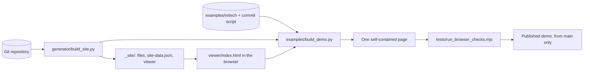

# Architecture

repo-pages has no server and no frontend build step. A generator turns a git repository into static files, and one HTML file reads those files in the browser.



## Parts

| Part | Path | What it does |
|---|---|---|
| Viewer | `viewer/index.html` | The whole interface, in one file with inline CSS and JavaScript |
| Vendored libraries | `viewer/vendor/` | `marked` and DOMPurify, loaded on the first Markdown render |
| Generator | `generator/build_site.py` | Copies published files, adds the viewer and writes `site-data.json` |
| Generator tests | `generator/test_build_site.py` | Standard library `unittest` tests that build temporary repositories |
| Sample | `examples/initech/`, `examples/initech-history.json` | 88 parody files, and a script of 41 commits that gives them a history |
| Demo build | `examples/build_demo.py` | Replays the history, runs the generator and folds everything into one page |
| Browser checks | `tests/browser_checks.js` | 64 settings behavior checks that run inside the page |
| Check runner | `tests/run_browser_checks.mjs` | Opens a build or a URL in a browser and fails on any failed check |
| Workflow | `.github/workflows/demo.yml` | Runs the tests, build and checks, then publishes the demo from `main` |
| Vendor watch | `tests/vendor-watch/package.json` | Lists the vendored versions so Dependabot reports updates. Nothing installs it |
| Action | `action.yml` | Checks, builds and deploys a repository, using this repository's viewer and generator |
| Preflight | `generator/preflight.py` | Refuses a private repository, and turns setup mistakes into errors that name the fix |
| Adopter workflow | `templates/repo-pages.yml` | The one file an adopter adds. It carries the permissions and environment |

## The action

An adopter adds `templates/repo-pages.yml` and copies nothing. The workflow runs `prisant-labs/repo-pages@v1`, a composite action, and GitHub downloads this repository for the run. The action finds the viewer and generator through `$GITHUB_ACTION_PATH`, so they always come from the same commit.

| Step | What it does |
|---|---|
| Preflight | Stops on a private repository, and on missing Pages settings or `id-token: write`. It runs first, so nothing is checked out or built on a refusal |
| Checkout | Fetches full history, because authors and dates come from git. It keeps no credentials on disk, because the build does not need them |
| Build | Runs `build_site.py --viewer` into a temporary folder, and writes the published file list to the run's summary page |
| Upload and deploy | Publish the folder to GitHub Pages. The `deploy: false` input skips these steps and the preflight |

Some choices here are worth keeping:

- **The inner actions are pinned to commit SHAs,** because every adopter inherits them. A moved tag upstream cannot change what runs.
- **The upload sets `include-hidden-files: true`.** The upload action otherwise drops dotfiles, which would silently undo `includeHidden`. The generator stays the only place that decides what gets published.
- **A composite action cannot set permissions or an environment,** so the adopter's workflow carries them. The deploy needs `pages: write` and `id-token: write`. It succeeds without `environment`, but the template keeps it, because `deploy-pages` recommends it and it puts the URL on the run page.
- **The preflight cannot detect a missing `pages: write` on a public repository,** because reading the settings still succeeds. `deploy-pages` fails with a message that names the permission.

`demo.yml` runs the action with `deploy: false` on every pull request, and checks what it built.

## Two layouts

This repository keeps the viewer in `viewer/` and the generator in `generator/`, because they are the product here.

Without `--viewer`, the generator reads the viewer from `.github/site/` in the repository it publishes. `build_demo.py` sets up that layout in a temporary repository. `.github/**` is never published, so neither the viewer's source nor the config appears as a site file.

The generator reads its config from `.github/repo-pages.json`, and falls back to `.github/site/config.json`.

## What the generator publishes

The generator publishes tracked regular files, minus `.github/**`, hidden files and `exclude` patterns. It reads each file's mode from `git ls-files -s` and skips symlinks and submodules. Copying a symlink would publish its target, which can be outside the repository or a file that `exclude` hides.

## The data contract

The generator writes `site-data.json` next to the viewer. It holds the site config, the commit list and one entry per file. Each file entry holds the size, the last change, the first add and the Markdown front matter. A rename map comes from the `R` lines in `git log`. The viewer reads nothing else at boot, so another data source could replace git without viewer changes.

## How the demo works

`build_demo.py` does four things:

1. It replays `initech-history.json` into a temporary git repository, with backdated authors and commit dates.
2. It runs the real generator on that repository.
3. It swaps three lines in the viewer, so files load from the page instead of the server. Each swap must match exactly once, so the build stops if those lines change.
4. It writes one HTML file with the libraries, the data file and every published file inlined. It also adds a `noindex` tag, which matches the projects hub until the project is announced.

Dates are relative to the build, so the output changes on every run. **Do not commit the built page.** Build it where you need it.

## Continuous integration

`.github/workflows/demo.yml` runs on every pull request, and on pushes to `main` that touch `viewer/`, `generator/`, `examples/`, `tests/`, `action.yml` or the workflow. It can also be started by hand. Pull requests have no path filter because a required check must report on every pull request, including docs-only ones.

| Job | Runs on | What it does |
|---|---|---|
| `build` | Every trigger | Runs the action in build-only mode, tests the generator, builds the demo, runs the browser checks and uploads the page |
| `deploy` | `main` only, not pull requests | Publishes the uploaded page to GitHub Pages |

The demo comes from the viewer and generator in the same commit, so it cannot fall behind them. A failed test or check stops the run before anything is published.

The "Protect main" ruleset requires the `build` check on every pull request. It also requires a pull request for every change to `main`, allows squash merges only, and blocks force pushes and branch deletion. Repository admins can bypass only the pull request requirement.

The built page is the viewer, the generator's output and the sample content. It is served at <https://projects.prisantlabs.com/repo-pages/>, because the organization's site owns that domain.

## Settings

All reader settings go through one registry, `PREF_SPEC`, in the viewer. Each entry holds a storage key, a validator and a default. The popover is built from a settings list, and Reset reads its defaults from the registry. A new setting therefore gets validation and reset without extra code. [settings-spec.md](settings-spec.md) has the behavior, and [design.md](design.md) has the measurements.

## Verifying a change

Run these from the repository root. Playwright is not a project dependency, so install it when you need it.

```bash
python3 generator/test_build_site.py
python3 examples/build_demo.py --viewer viewer --generator generator/build_site.py
npm install --no-save --no-package-lock playwright
npx playwright install chromium
node tests/run_browser_checks.mjs
```

The generator tests do not cover the viewer. The browser checks cover settings behavior on one Markdown file, so a change to another view still needs a look in the browser.
