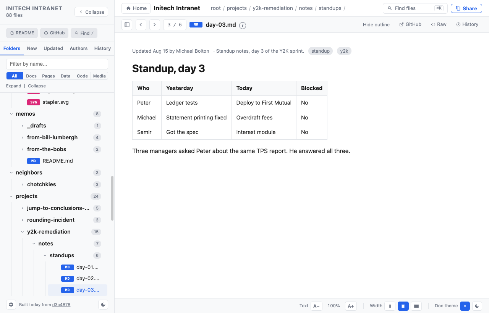
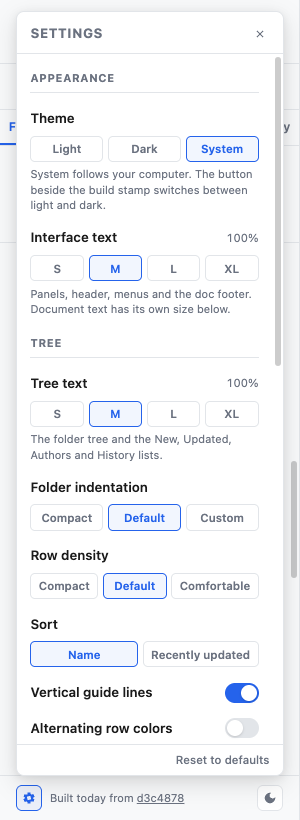
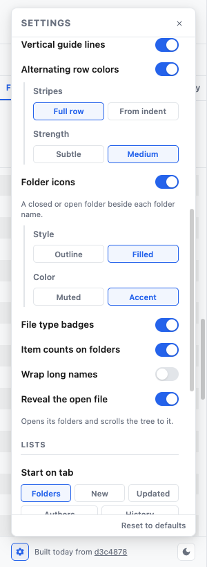
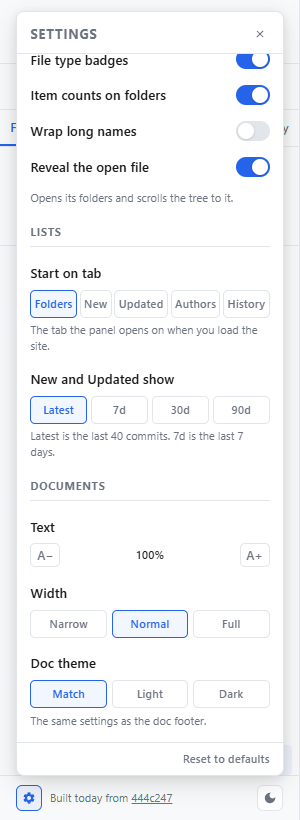
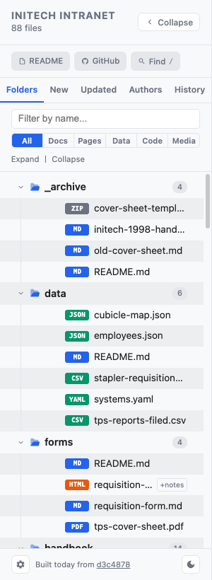
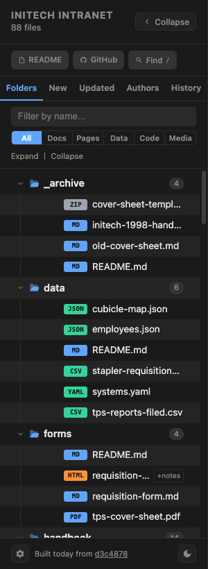
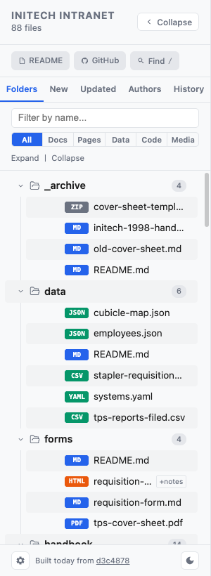
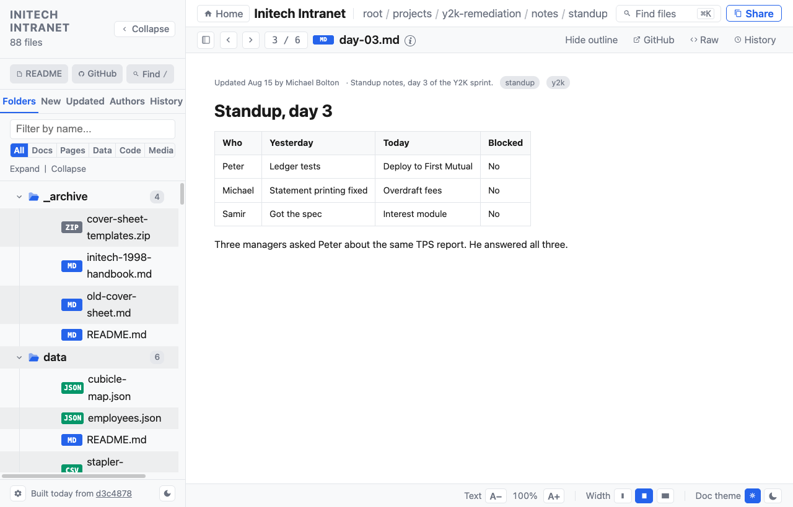
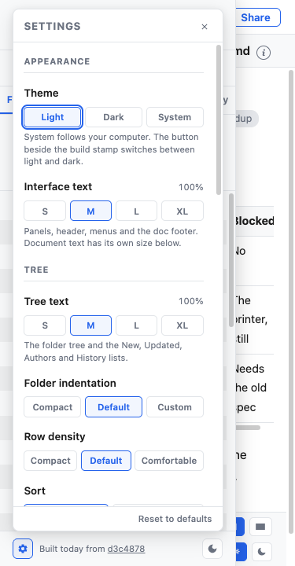

# Sidebar display settings: design

This document holds the measurements, colors and exact wording. [settings-spec.md](settings-spec.md) holds the behavior. All sizes below are in the units the viewer uses. The viewer's root font size is 115%, which makes `1rem` equal 18.4px in the screenshots. If your root size differs, `rem` values scale with it and `px` values do not.

The screenshots use the Initech sample repo.

## Screenshots

### The sidebar at default settings

The gear is at the lower left and the light/dark button at the lower right. Stripes and folder icons are off until a reader turns them on.

### The settings popover

| Appearance and the top of Tree | Sub-options under their toggles | Lists and Documents |
|---|---|---|
|  |  |  |

### Stripes and folder icons

| Full row, Medium, Filled, Accent (light) | The same in dark | From indent, Subtle, Outline, Muted |
|---|---|---|
|  |  |  |

### XL text with wrapped names

Interface text and Tree text are both at XL. Option rows and tabs fit, names wrap, and the document text has not changed size.

### Phone width

At 375px wide the popover stays inside the drawer and the page does not scroll sideways.

## Popover contents, top to bottom

Use this wording exactly. A dash in the Hint column means the row has no hint.

| Section | Label | Options, in order | Hint |
|---|---|---|---|
| Appearance | Theme | Light, Dark, System | System follows your computer. The button beside the build stamp switches between light and dark. |
| Appearance | Interface text, with the percent at the right | S, M, L, XL (each has its percent as a tooltip) | Panels, header, menus and the doc footer. Document text has its own size below. |
| Tree | Tree text, with the percent at the right | S, M, L, XL | The folder tree and the New, Updated, Authors and History lists. |
| Tree | Folder indentation | Compact, Default, Custom | - |
| Tree | Indentation, for Custom only | Number field with the unit `rem` | - |
| Tree | Row density | Compact, Default, Comfortable | - |
| Tree | Sort | Name, Recently updated | - |
| Tree | Vertical guide lines | Toggle | - |
| Tree | Alternating row colors | Toggle | - |
| Tree, sub-option | Stripes | Full row, From indent | - |
| Tree, sub-option | Strength | Subtle, Medium | - |
| Tree | Folder icons | Toggle | A closed or open folder beside each folder name. |
| Tree, sub-option | Style | Outline, Filled | - |
| Tree, sub-option | Color | Muted, Accent | - |
| Tree | File type badges | Toggle | - |
| Tree | Item counts on folders | Toggle | - |
| Tree | Wrap long names | Toggle | - |
| Tree | Reveal the open file | Toggle | Opens its folders and scrolls the tree to it. |
| Lists | Start on tab | Folders, New, Updated, Authors, History | The tab the panel opens on when you load the site. |
| Lists | New and Updated show | Latest, 7d, 30d, 90d | Latest is the last 40 commits. 7d is the last 7 days. |
| Documents | Text | A−, the percent, A+ | - |
| Documents | Width | Narrow, Normal, Full | - |
| Documents | Doc theme | Match, Light, Dark | The same settings as the doc footer. |

The footer holds "Reset to defaults", aligned right.

## Popover layout

The popover is one column with a fixed header, a scrolling body and a fixed footer.

| Part | Values |
|---|---|
| Position | `bottom: calc(0.5rem + 26px + 0.5rem)`, `left: 0.85rem`, so it sits above the gear |
| Width | `calc(var(--nav-width) - 1.7rem)`, which follows the resizable sidebar |
| Maximum height | `calc(100% - 26px - 1.6rem)` of the panel |
| Body | Padding `0.65rem 0.75rem 0.8rem`, gap `0.8rem`, scrolls vertically, `min-height: 0` so the column can shrink |
| Section label | Gains `margin-top: 0.15rem` |
| Toggle row | Label and switch on one line, with a `0.5rem` gap |
| Hint | Muted color, line height 1.4, `margin-top: -0.1rem` to sit close to its control |
| Value at the right of a label | Muted color, tabular numbers |
| Sub-option group | Column with gap `0.55rem`, `margin: -0.35rem 0 0 0.2rem`, `padding: 0.15rem 0 0.1rem 0.65rem`, and a 2px left border in the border color |
| Sub-option label | Muted color and smaller than a normal label |

### Option buttons

The option rows use flexbox rather than a fixed grid, so they can wrap at large text.

- The row wraps, with a `0.25rem` gap.
- Each button has `flex: 1 0 0`, `min-width: max-content`, `white-space: nowrap` and padding `0.3rem 0.4rem`.
- A row of five options, which is only Start on tab, adds the class `tight`. It has a `0.15rem` gap and no side padding, and each button has `flex: 1 1 auto`. This keeps the row on one line at default text size in the 300px panel, and the buttons share what is left over.
- The date buttons use short labels, `7d`, `30d` and `90d`, and spell out the window in their tooltips.
- Buttons are equal width while they fit. When they stop fitting, they wrap to a second line and keep their labels whole.
- The selected style is the existing one: accent border, accent text and the accent hover background.

### Document text stepper

A− and A+ are buttons with a minimum width of 30px and a height of 24px, with the percent centered between them. A button is disabled at the end of the step list. This row keeps a stepper because the document scale has seven steps.

## Footer and tabs

| Element | Values |
|---|---|
| Nav footer gap | `0.45rem`, up from `0.3rem` |
| Build stamp | `flex: 1` with an ellipsis when it does not fit |
| Nav tabs | A flex row in place of the five-column grid. Each tab has `flex: 1 1 auto`, `min-width: 0`, `white-space: nowrap`, an ellipsis as the fallback, and side padding `0.2rem` |

With the flex row, tabs take their width from their labels. All five fit at XL in the default 300px panel without clipping.

## Tree geometry

Four rules keep the tree aligned at every text size:

1. The guide line runs under the center of the chevron.
2. A file's badge starts where a sibling folder's name starts.
3. Everything that belongs to a row grows with `--tree-scale`.
4. One nesting level moves a row right by exactly the indent, in every indent mode.

| Value | Formula |
|---|---|
| Chevron size, `--tree-chev` | `13px × tree scale` |
| Folder icon size | `15px × tree scale` |
| Icon's share of the row, `--tree-icon-w` | `15px × tree scale + 0.35rem` when icons are on, `0` when off |
| Row left padding, `--tree-row-px` | `max(0, min(0.85rem, indent − 6.5px × tree scale))`. Compact and small Custom values shrink it, and Default never does |
| Row padding | `var(--tree-row-py) 0.85rem var(--tree-row-py) var(--tree-row-px)` |
| Chevron right margin | `0.3rem` |
| Icon right margin | `0.35rem` |
| File row left padding | `--tree-row-px + --tree-chev + 0.3rem + --tree-icon-w` |
| Guide-line x, `--tree-line-x` | `--tree-row-px + 6.5px × tree scale`, in every indent mode |
| Nested list | `margin-left` is the guide-line x, `padding-left` is `max(0px, indent − guide-line x)`, and the left border is the guide line |

Tree rows need `position: relative`, because full-row stripes are placed against them.

### Row density

| Option | `--tree-row-py` |
|---|---|
| Compact | `0.1rem` |
| Default | `0.22rem` |
| Comfortable | `0.36rem` |

### Wrapped names

Wrapping turns off `white-space: nowrap` on tree rows. The name gets `overflow-wrap: anywhere` and `min-width: 7em`. The chevron and icon stay vertically centered on the row.

## Alternating rows

A stripe is always a pseudo-element behind its row, with `z-index: -1` and `pointer-events: none`. The row itself keeps a transparent background. Hover and selected colors are backgrounds on the row, so they add to the stripe instead of replacing it.

| Layer | How it is painted |
|---|---|
| From indent | The pseudo-element fills the row: `left: 0`, `right: 0`, `border-radius: 4px` |
| Full row | The pseudo-element runs the panel's width: `left: -400px`, `right: -0.4rem`, `border-radius: 0` |
| The list container | `isolation: isolate`. This keeps the negative layer in front of the panel background and behind the guide lines, which are borders on the nested lists |

The negative left offset does not add a horizontal scrollbar, because scrollable overflow only extends to the right in a left-to-right layout.

A hovered row measured 9 to 12 brightness levels away from its resting color, on striped and plain rows alike, in both spans, both strengths and both themes.

### Color tokens

The two tokens need defining in all three theme blocks: the default, the explicit dark attribute and the `prefers-color-scheme: dark` block.

| Token | Light | Dark |
|---|---|---|
| `--zebra` (Subtle) | `rgba(0,0,0,0.022)` | `rgba(255,255,255,0.022)` |
| `--zebra-strong` (Medium) | `rgba(0,0,0,0.045)` | `rgba(255,255,255,0.045)` |

The existing hover token is `rgba(0,0,0,0.04)` in light and `rgba(255,255,255,0.05)` in dark, which is close to Medium. Painting a stripe as the row's own background would let hover replace it with a nearly equal color, so the hover would not show.

## Folder icons

Every folder row holds both shapes, and the row's `.open` class chooses which one shows. A folder that opens or closes needs no icon change in code.

| Style | Closed | Open |
|---|---|---|
| Outline | Lucide `folder` shape, no fill, stroke in `currentColor`, stroke width 1.9, round joins and caps | Lucide `folder-open` shape, same stroke |
| Filled | The `folder` shape, filled with `currentColor` | Two filled layers: a back panel at 50% opacity, and a solid front flap that slants forward. Draw these on a 24 × 24 grid to match the `folder-open` silhouette |

| Color | Value |
|---|---|
| Muted | `--text-muted` |
| Accent | `--accent` |

### License for the icon shapes

The outline shapes come from [Lucide](https://lucide.dev), which uses the ISC license. Its `folder-open` path is used as it stands, and the `folder` shape is the same outline. The Lucide copyright and permission notice is in [THIRD-PARTY-NOTICES.md](../THIRD-PARTY-NOTICES.md), and it must stay with the viewer.

## Type scale

Each size below is multiplied by its scale. All other font sizes in the viewer are unchanged.

### Multiplied by `--ui-scale`

| Area | Element and base size (rem) |
|---|---|
| Panel header | Title 0.78, file count 0.68, Collapse button 0.65 |
| Chips | Chip 0.62, its key hint 0.55 |
| Tabs and toolbar | Tab 0.66, filter input 0.74, type filter 0.6, Expand and Collapse 0.62 |
| Panel footer | Footer text 0.6 |
| Counts | Folder count pill 0.58 (the sidebar overrides this, see below) |
| Popover | Title 0.72, section 0.6, label 0.72, toggle label 0.72, sub-option label 0.66, value 0.62, hint 0.6, option 0.62, stepper button 0.66, custom label 0.63, custom input 0.68, unit 0.63, Reset 0.62 |
| Header | Home button 0.7, site title 0.9, breadcrumb 0.76, search trigger 0.7, its key hint 0.6, Share 0.72, file counter 0.66, Browse 0.7, file name 0.82, info icon 0.6, source links 0.68, segmented buttons 0.64 |
| Menus and info | Menu item 0.76, menu number 0.6, info popover 0.7, info code 0.66 |
| Doc footer | Footer 0.64, buttons 0.66 |
| Palette | Input 0.9, heading 0.66, result name 0.74, result path 0.6, result snippet 0.66, footer 0.6 |
| Type badges | 0.5, in the header row, menus and palette only. Page badges are content and keep this size unscaled |
| Toast | 0.72 |

### Multiplied by `--tree-scale`, inside the sidebar's list only

| Element | Base size (rem) |
|---|---|
| Folder row | 0.78 |
| File row | 0.74 |
| Count pill | 0.58 |
| Type badge | 0.5 |
| Paired-notes marker | 0.55 |
| Author group heading | 0.66 |
| Commit message | 0.72 |
| Commit details | 0.6 |
| List row name | 0.74 |
| List row path | 0.6 |
| Added or Updated label | 0.52 |
| Empty message | 0.72 |

Document text keeps its own multiplier, `--md-text-scale`, and is unchanged. At XL interface and tree text, body text measured 15.8px, which is its 100% size.
