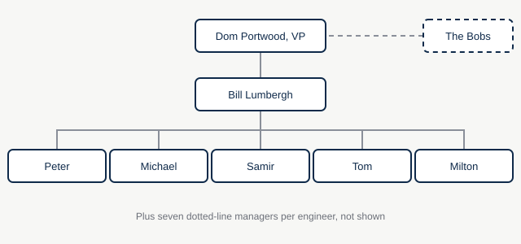
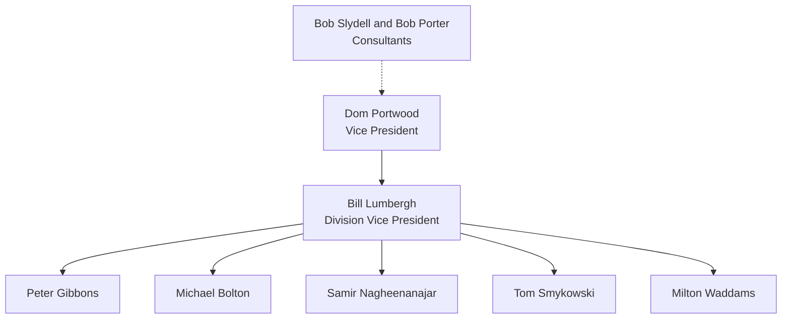

# Org chart

## As text

## Matrix reporting

Software engineers have a direct manager and up to seven dotted-line managers. When two managers ask about the same TPS report, answer both. Copying them on one reply has been tried.

## Consultants

The Bobs report to the vice president for the length of the [efficiency review](../memos/from-the-bobs/efficiency-review-kickoff.md). They have asked everyone what they would say they do here.
